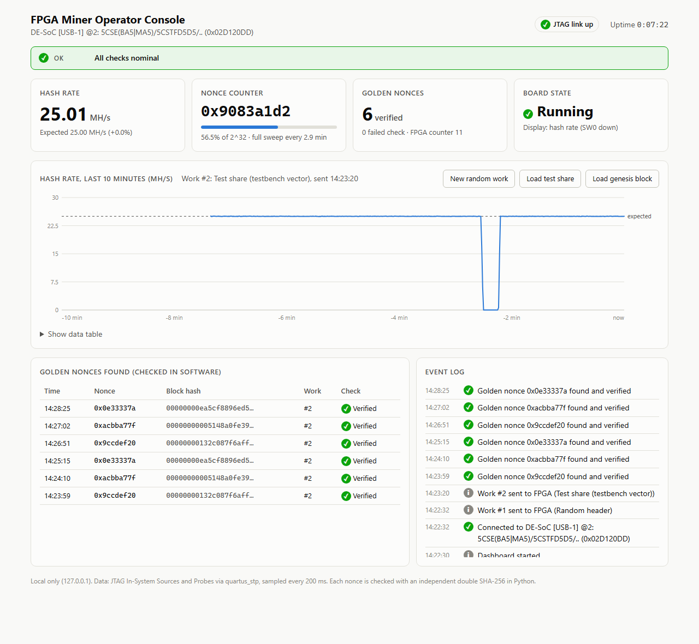

Open-Source FPGA Bitcoin Miner
==============================================

DE1-SoC Port (this fork)
------------------------

This fork ports the miner to the **Terasic DE1-SoC** (Intel/Altera Cyclone V SoC,
5CSEMA5F31C6) and current Quartus Prime Lite tooling (25.1). It adds a hardware
self-test with known-answer vectors. The original project targeted Cyclone IV
boards and Quartus II 10.x from 2011.

**Status: running on hardware.** Verified on a DE1-SoC:

| Metric | Result |
|--------|--------|
| Logic utilization | 19,433 / 32,070 ALMs (61%), 31,107 registers, including the on-board HMI |
| Hash clock | 100 MHz from `altera_pll`. Timing met at all corners: worst-case setup slack +0.248 ns (slow 85 C), Fmax 102.5 MHz |
| Hash rate | 25.00 MH/s measured over JTAG |
| Self-test | 2/2 known-answer vectors passed on the board |
| Independent check | The FPGA also found two nonces that were not planted (`0x9ccdef20`, `0xacbba77f`). Both were confirmed as valid with `hashlib` |



*The operator dashboard running live against the DE1-SoC: 25 MH/s, with six
golden nonces found by the FPGA and each re-verified in software. The dip to
0 MH/s is an operator halt test using SW9 on the board.*

### How it works

#### Bitcoin mining in one paragraph

A Bitcoin block header is 80 bytes: version, previous block hash, Merkle root
of the block's transactions, timestamp, difficulty target (`bits`) and a 32-bit
**nonce**. The block's hash is `SHA-256(SHA-256(header))`, read as a 256-bit
little-endian number. A block is valid only if that number is below the
network target. SHA-256 cannot be reversed, so the only way to find a valid
header is to try nonces one after another and hash each one. That is the work
in proof-of-work. The miner whose header meets the target first earns the block
reward, which is paid to an address in a transaction the miner put in the block.

#### SHA-256

SHA-256 processes data in 512-bit blocks and keeps a state of eight 32-bit
words `H0..H7`, starting from fixed constants. Each block goes through one
*compression*:

1. **Message schedule.** The block supplies 16 words `W0..W15`. 48 more are
   derived as `W[t] = σ1(W[t-2]) + W[t-7] + σ0(W[t-15]) + W[t-16]`, where σ0
   and σ1 are fixed rotate/shift/XOR mixes.
2. **64 rounds.** Working variables `a..h` start from the state. Each round
   computes `T1 = h + Σ1(e) + Ch(e,f,g) + K[t] + W[t]` and
   `T2 = Σ0(a) + Maj(a,b,c)`, then shifts the variables down one place, with
   `e += T1` and a new `a = T1 + T2`. Ch ("choose") and Maj ("majority") are
   bitwise selectors, and `K[t]` are 64 fixed constants.
3. **Feed-forward.** The final `a..h` are added to the starting state, giving
   the new `H0..H7`.

All arithmetic is 32-bit addition modulo 2^32. A padded 80-byte header is two
blocks; the 32-byte result of the first hash, padded, is one more.

#### How this hardware computes it

| Step | Where | What |
|------|-------|------|
| Midstate | Host, once per work unit | The first 64 bytes of the header contain no nonce, so their compression is the same for every nonce. The host computes it once and writes the result (`STAT`) to the FPGA. The remaining 12 header bytes go in `DAT2`. |
| Hash 1, block 2 | FPGA | Starting from the midstate: the last 12 header bytes, plus the nonce, plus SHA-256 padding. |
| Hash 2 | FPGA | SHA-256 of the 32-byte result, starting from the standard initial values. |
| Target check | FPGA, then host | The FPGA flags a **golden nonce** when the top 32 bits of the final hash are zero, meaning it is below 2^224 ("difficulty 1"). The host then checks the full hash in software. |

That is 2 compressions, or 128 rounds, per nonce. Each round is one
`sha256_digester`: one round's adders plus pipeline registers holding the
working variables and a 16-word sliding window of the message schedule. Most of
the 31k registers are in these windows. `sha256_transform` chains round units
into a pipeline:

- **`CONFIG_LOOP_LOG2=0`**: 64 units per compression, 128 in total. One new
  nonce enters every clock.
- **`CONFIG_LOOP_LOG2=2`** (this build): 16 units per compression, 32 in total,
  each reused for 4 consecutive rounds. That is a quarter of the logic and a quarter of the
  throughput, so 100 MHz / 4 = **25 MH/s**.

Because the pipeline is deep, the nonce counter has moved on by the time a
result comes out. The reported nonce is therefore `current nonce − pipeline
latency`, which is why the HMI masks the check while the counter is halted.

#### Can it make money? No, by about ten orders of magnitude

Figures as of November 2026: network hash rate about 1,000 EH/s (10^21 hashes
per second), difficulty about 148 T, block reward 3.125 BTC.

| | |
|---|---|
| This board's share of the network | 25 × 10^6 / 10^21 = **2.5 × 10^-14** |
| Hashes needed to find one block | difficulty × 2^32 ≈ 6 × 10^23 |
| Expected time to find a block solo | **about 800 million years** at 25 MH/s |
| Expected earnings at the board's share | 450 BTC/day × 2.5 × 10^-14 ≈ **0.4 satoshi per year** (1 satoshi = 10^-8 BTC) |
| Electricity | A few watts, costing far more than that |

A real block needs roughly 79 leading zero bits in the hash. This design's
golden nonces have 32. They prove the pipeline computes SHA-256 correctly, but
they are worth nothing on the network.

Pools don't help either. They pay out per *share* of work, but their minimum
share difficulty is far above difficulty 1, and they now use the Stratum
protocol rather than the getwork protocol this code speaks. A single current
ASIC miner runs at hundreds of TH/s, millions of times faster than this board.
Mining for real would also need a Bitcoin address to receive payouts, which
this project deliberately does not have.

This is an FPGA design, verification and HMI exercise that uses Bitcoin's
hashing as a well-defined, independently checkable workload.

### What changed

| Area | Change |
|------|--------|
| Board support | New `boards/DE1_SoC` pin and device constraints (50 MHz clock on `PIN_AF14`). |
| Clocking | New `cores/cyclone_v_pll`: Cyclone V has no `altpll`, so this wraps `altera_pll`. It keeps the same integer parameters as the Cyclone IV version, so the shared top-level is unchanged. `altera_pll` takes its frequencies as strings, which are generated in SystemVerilog as typed `string` parameters. Plain Verilog bit-vector strings are rejected by Quartus (Error 114000). The PLL is bypassed when no frequency change is needed. |
| Project | `projects/DE1_SoC_Unoptimized_Pipelined`: SHA-256 pipeline with 32 round units (16 per compression, each reused 4 times; `CONFIG_LOOP_LOG2=2`), clocked at 100 MHz, giving 25 MH/s. The 64-stage configuration needed 37.8k ALMs (118% of the device), so the design trades pipeline depth for clock rate. |
| JTAG / programming | On SoC boards the ARM HPS debug port is first on the JTAG chain (`@1`) and the FPGA is second (`@2`). The original script programmed `@1`. It now finds the FPGA by name, and skips the device prompts when there is only one choice. |
| Tooling | `scripts/de1soc`: one-step build, program and Quartus install scripts, using 64-bit Quartus binaries. |

### Verification approach

The FPGA talks to the host through In-System Sources and Probes over JTAG. The
host writes the midstate (`STAT`) and block-header tail (`DAT2`), and reads back
the golden nonce (`GNON`) and the live nonce counter (`NONC`).

1. **Known-answer vectors, checked against a reference model**
   (`scripts/test/test_vectors.py`). It builds the exact `STAT`/`DAT2` words the
   host writes for two real block headers: a share from the original testbench,
   and the Bitcoin genesis block. A bit-accurate Python model of the RTL datapath
   (word ordering, padding, the double SHA-256 and the golden-ticket comparison)
   then runs on those words. The result is cross-checked against `hashlib`, and a
   negative case (nonce + 1) must fail. Writing this model exposed and fixed a
   padding/byte-order error before it reached hardware.
2. **Hardware self-test** (`scripts/test/selftest.tcl`). It drives the real board
   over JTAG with those vectors and passes only when the reported nonce matches.
   It is designed around the hardware's behaviour:
   - The nonce counter free-runs and isn't reset when new work arrives. The test
     therefore tracks how far the counter has travelled, modulo 2^32, and checks
     the result only once the counter has swept past the expected nonce.
   - Two vectors with different answers run back to back, so a result left over
     from an earlier run cannot produce a false pass.
   - A stalled counter (no hash clock) is detected and reported as its own
     failure. Hash rate is measured live.
3. **Host-side tests without hardware.** The self-test and programming scripts
   were run against a mocked Quartus JTAG API that simulates the DE1-SoC's
   two-device chain. This covered the pass path, the broken-firmware path, the
   stalled-clock path, and FPGA (`@2`) selection.

### Operator interface (HMI)

There are two layers, both reading the same firmware. Details are in
[`scripts/hmi/README.md`](scripts/hmi/README.md).

- **On the board:** the 7-segment displays show the hash rate, measured in
  hardware against the board oscillator (independent of the PLL), or the last
  nonce found. The LEDs show pipeline and board heartbeats, halted, new work,
  nonce found, and a found counter. **SW9 is an operator halt.** The
  golden-ticket check is masked while halted and until the pipeline refills, so
  a halt cannot produce a false nonce.
- **On the PC:** a local dashboard over JTAG. It shows live hash rate and trend,
  nonce sweep progress, and a log of nonces found. Each nonce is **independently
  re-verified in software** against the work sent to the FPGA. Alarms follow the
  ISA-18.2 latch-and-acknowledge pattern: link loss, stalled pipeline, failed
  verification (latched until acknowledged), rate out of tolerance, and
  operator halt. Alarms are evaluated continuously in the background, so they
  are logged even when no browser is open. See the screenshot at the top.

### Quick start (Windows)

```
scripts\de1soc\install-quartus.ps1   # or install Quartus Prime Lite + Cyclone V + USB-Blaster II driver manually
python scripts\test\test_vectors.py  # offline vector check, no board needed
scripts\de1soc\build.bat             # synthesize, fit, timing analysis -> fpgaminer.sof
scripts\de1soc\program.bat           # load the FPGA over the on-board USB-Blaster II
scripts\test\selftest.bat            # on-hardware known-answer test
scripts\hmi\dashboard.bat            # operator dashboard at http://127.0.0.1:8080
```

See `projects/DE1_SoC_Unoptimized_Pipelined/README.md` for configuration and
tuning. *Note:* the `scripts/mine` pool client uses the legacy getwork protocol,
which modern pools no longer serve. This fork is an FPGA design and verification
exercise, not a profitable miner.

--------------------------------------------------------------------------------

*The original project README follows.*

--------------------------------------------------------------------------------
Copyright (C) 2011 fpgaminer@bitcoin-mining.com

See LICENSE.txt


Purpose
-------

To promote the free and open development of an FPGA based Bitcoin mining solution.

http://www.weusecoins.com/

http://bitcoin.org/


Project Status
--------------

Project is fully functional and allows mining of Bitcoins both in a Pool and Solo.
It also supports Namecoins.

**Current Performance:** 109 MHash/s
*On a Terasic DE2-115 Development Board*

*Note: The included default configuration file, and source files, are built for
50 MHash/s performance (downclocked). This is meant to prevent damage to your valuable
chip if you don't provide an appropriate cooling solution.*


Contributors
------------

These people have worked hard to enhance and promote the Open-Source FPGA Bitcoin Miner
project:
*Not listed in any particular order*

**teknohog**
1HkL2iLLQe3KJuNCgKPc8ViZs83NJyyQDM

**OrphanedGland**
1PioyqqFWXbKryxysGqoq5XAu9MTRANCEP

**udif**

**TheSeven**
14Jc8vWq1mPv7vWnP5VquZZgpLEtzW2vja

**makomk**
15XX7BhQcZFUg47S4VKyiLygPTHTs9234J

**newMeat1**
1LbqTCA1cnpbbdKbXzZZfHYMe7teiczQc2


Supported Devices
------------------

Both Xilinx and Altera devices are currently supported. A binary configuration file and tools
are provided for the Terasic DE2-115 Development Board, so it is easy to get up and running
with that board. For other devices, you can modify and compile the correct projects for your
specific development board.


Installation Instructions (for Terasic DE2-115)
-------------------------


### Required Equipment:
* DE2-115 Development Kit (this is *not* a DE2. It has a Cyclone IV EP4CE115.)
* USB Cable
* Windows PC (Linux is also supported, but not documented)
* Altera's Quartus II (installed on PC)


###Instructions:

####Do These Once:

1) *IMPORTANT*: Please remove the clear acrylic cover on your DE2-115 board. This will restrict
air flow and may cause the chip to overheat.

2) Navigate to 'scripts/mine' and follow the instructions in 'config.example.tcl' (open in Notepad or other text editor)

####Do these each time you want to run the miner:

1) Connect the DE2-115 Development Kit to your PC through USB, connect its power, and turn it on.

2) Ensure that the DE2-115's drivers have been installed successfully on your PC.
Consult the DE2-115 User Guide for more information on setting up the DE2-115.

3) Navigate to 'scripts/program' and run 'program-fpga-board.bat'.

4) Follow the instructions provided by the program-fpga-board script.
Select the correct cable and programming file.
Once programming has succeeded, the DE2-115 is now ready to mine!

*Note: This script sometimes fails immediately upon execution. Please try running it again.*

5) Run 'mine.bat'

6) If working correctly, 'mine.bat' will leave a console window open where it reports hashing rate, estimated hashing rate and accepted/rejected share information.

7) Profit!


####Notes:
* You need to re-program the DE2-115 every time it is powered off and on again. Repeat steps 1 through 7 for subsequent uses.
* Your PC needs to stay on and connected to the internet. It is acting like a controller for the FPGA,
feeding it data and getting back valid hashes.


Thank You!
--------------------

--------------------


```
-----BEGIN PGP SIGNED MESSAGE-----
Hash: SHA1

fpgaminer@bitcoin-mining.com
Donation Address: 1E1XgiJAzm1Wn7ZWuhkryzBoViBJ7CcRCQ

Donations are most welcome! They will be used to buy more equipment. I'm currently trying to get
an ethernet module up and running so the miner can run all on its own.
-----BEGIN PGP SIGNATURE-----
Version: GnuPG v1.4.11 (MingW32)

iQIcBAEBAgAGBQJN1dAzAAoJEFFoGj2A5YKRt/IP/3LaZlEWvdUpAxcs5ANS3fcA
NdKFiIycfnBKtmXjXiHQk4DZY+tbvuPPggzFHBA7k+3wV3WBOF2rjQiorODZff6q
xb6gSVINUXucv/+SDzqx8CtjMa17wzSayiczC03t+IICYs2/atdLAFvbr0LwdbqZ
oBQRgYK4hD39fQzD8v/L26glh3va72ZibuO043uH/WMFgcQseTFHF7QPLJm0k0A/
nx5p0cTtqqSf4g9MQICnNU8MGVrXXOGZU4DeItbJjNcvsomzmibha+9jQ2K8XD8F
KzbdTK+YzvdzcDMaeOgs70SnVEFfUS1ykbdDC850M6qkRP79HBqH7Neq1Rld5ktj
Mrd2hHC4NC0fgMD3hUbTjfIcCZOPwKYvp5oCLYYO1CqzV64Ag0o9qZDr8FS+9Npv
PEbWQpQuZqqtkhppVcCmOv4bl8XWTuQJEoxP8rWkJdfhkDUt5hwQsFrMQB7goXDc
pJZu1wnWdzpgcDyNjkNDp6sqnJGzCgft7o3hPiZO79BZZRLtdRSMHa0RdJJK5zLv
8JqOJCJUFhVZHSKsHyGdJHppjKk/yZbBGLuJUTAfrMk5I/X5b/V9TGiWKoPN3zce
Hdd5LQF5Z881wCgrnPz2dwR5oXMUcWqd//ZAs7Jcnvp6Bz5HWrFH5FBgpfg0K3c6
qBmd3GhQgxnFsBW62dAJ
=Lvja
-----END PGP SIGNATURE-----
```


